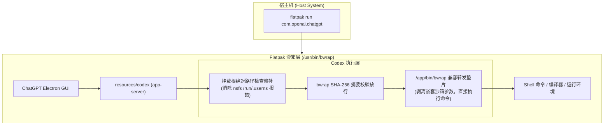
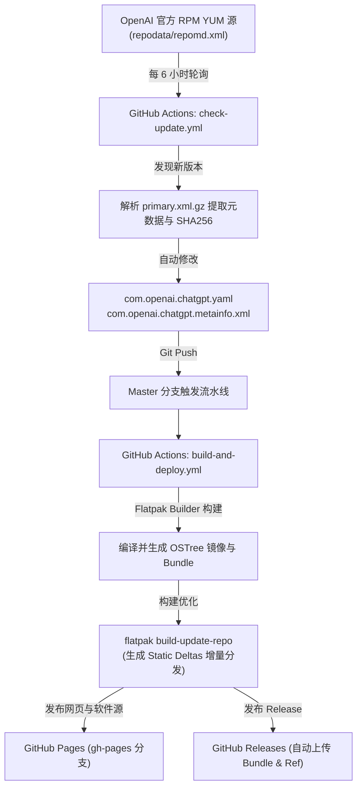

# ChatGPT Flatpak

<div align="center">
  
  <h3>OpenAI ChatGPT Linux Client — 生产级 Flatpak 打包与全自动更新项目</h3>
  <p>
    <a href="https://github.com/jhuang6451/chatgpt-flatpak/actions/workflows/build-and-deploy.yml"></a>
    <a href="https://github.com/jhuang6451/chatgpt-flatpak/actions/workflows/check-update.yml"></a>
    <a href="https://github.com/jhuang6451/chatgpt-flatpak/releases/latest"></a>
    
    
    <a href="LICENSE"></a>
  </p>
  <p>
    <b><a href="https://jhuang6451.github.io/chatgpt-flatpak/">🌐 在线仓库主页与一键安装</a></b>
  </p>
</div>

---

## 📖 项目简介 (Overview)

本仓库提供 OpenAI 官方 Linux 桌面客户端 **ChatGPT** 的生产级 Flatpak 打包方案。

针对主流 Linux 系统（Fedora Silverblue/Atomic、Ubuntu、Debian、Arch Linux、openSUSE、SteamOS 等），本项目实现了：
1. **完整修复 Codex Agent 命令执行**：内置轻量级兼容垫片与挂载表适配，彻底攻克 Flatpak 内部运行 Codex 时的 `mountinfo path is not absolute` 与 `bwrap` 嵌套冲突。
2. **读写权限无缝互通**：精细配置 `~/Documents`、`~/Downloads` 与用户目录的读写互通（修复官方规则中 xdg-documents 覆盖引起的只读问题）。
3. **一键安装与全自动更新**：配置专有 OSTree 仓库，GitHub Actions 每 6 小时监控 OpenAI 官方 YUM 软件源，新版发布时自动构建增量镜像并发布。
4. **Wayland 与原生环境优化**：自适应 Wayland / X11 显示通道，支持自定义启动参数文件 `~/.config/chatgpt-flags.conf`。

---

## 🚀 快速安装 (Quick Start)

### 方式 1：添加仓库一键安装（推荐，支持全自动日常更新）

直接在终端执行以下命令：

```bash
# 1. 添加 ChatGPT 软件源仓库
flatpak remote-add --if-not-exists chatgpt https://jhuang6451.github.io/chatgpt-flatpak/chatgpt.flatpakrepo

# 2. 安装 ChatGPT 客户端
flatpak install -y chatgpt com.openai.chatgpt

# 3. 运行应用
flatpak run com.openai.chatgpt
```

安装完成后，可以在桌面启动器（GNOME、KDE Plasma、XFCE 等）的应用列表中直接找到 **ChatGPT** 点击运行。

---

### 方式 2：使用 `.flatpakref` 单文件图形化安装

1. 访问在线页面 [https://jhuang6451.github.io/chatgpt-flatpak/](https://jhuang6451.github.io/chatgpt-flatpak/) 点击 **一键安装** 按钮，或在 [Releases](https://github.com/jhuang6451/chatgpt-flatpak/releases/latest) 下载 `chatgpt.flatpakref`。
2. 双击通过系统应用商店（GNOME Software 或 KDE Discover）一键安装，或在终端执行：
   ```bash
   flatpak install chatgpt.flatpakref
   ```

---

### 方式 3：离线单文件 Bundle 安装

对于无外网或特定局域网环境，可直接前往 [Releases 页面](https://github.com/jhuang6451/chatgpt-flatpak/releases/latest) 下载打包好的 `com.openai.chatgpt.flatpak` 单文件安装包：

```bash
flatpak install com.openai.chatgpt.flatpak
```

---

## 🔄 软件日常更新 (Updates)

由于配置了官方标准 Flatpak 仓库，后续所有的版本迭代均可跟随系统更新或执行单条指令完成：

```bash
# 更新 ChatGPT 到最新版
flatpak update com.openai.chatgpt

# 或随系统所有 Flatpak 应用批量更新
flatpak update
```

---

## 🛠️ 关键技术攻关与沙箱适配 (Technical Highlights)

ChatGPT 客户端内置了用于本地执行任务与分析工程的 **Codex CLI / app-server**。在 Flatpak 环境中，原生客户端会因为两层嵌套沙箱而导致命令通道全面瘫痪。本项目进行了以下底层工程化适配：



1. **消除挂载根非绝对路径报错 (`mountinfo path is not absolute`)**：
   * *根因*：Codex 在 `daemon_mounts.rs` 中解析 `/proc/self/mountinfo` 检查挂载点，要求所有挂载根以 `/` 开头。而 Flatpak 内置用于跟踪用户命名空间的锚点挂载为 `user:[<inode>] /run/.userns nsfs`，导致其在启动沙箱阶段立即返回错误。
   * *解决*：通过 `scripts/patch-codex.py` 精准修补条件跳转，安全放行非 `/` 开头的 nsfs 挂载点。
2. **解决嵌套 User Namespace 限制与摘要校验**：
   * *根因*：Flatpak 自身已处于 bubblewrap 沙箱中，默认 seccomp 阻止二次创建 unprivileged user namespace（`CLONE_NEWUSER`）。同时 Codex 对内置的 `bwrap` 实施了硬编码的 SHA-256 完整性检查。
   * *解决*：构建原生 ELF C 语言垫片（`bwrap_shim.c`），解析 `--argv0 codex-linux-sandbox`，剥离二层嵌套参数并透明移交命令至 Flatpak 容器内部直接执行；并在二进制中无条件放行该垫片。
3. **Documents 读写权限恢复**：
   * 清单中规范声明 `--filesystem=xdg-documents` 与 `--filesystem=home`，确保 Codex 对 `~/Documents/Codex` 项目工作区具备完整的创建、读写与修改权限。

---

## ⚙️ 自动化流水线架构 (Automation Architecture)

本项目采用全自动化生产级 CI/CD 流水线，实现了免人工维护的端到端持续交付：



---

## 💻 本地构建与调试 (Local Development)

如需在本地测试修改或自行构建：

```bash
# 1. 克隆本仓库
git clone https://github.com/jhuang6451/chatgpt-flatpak.git
cd chatgpt-flatpak

# 2. 一键本地构建、生成仓库与 Bundle
./scripts/build-local.sh

# 3. 安装本地构建的单文件包进行测试
flatpak install --user --bundle com.openai.chatgpt.flatpak

# 4. 运行
flatpak run com.openai.chatgpt
```

---

## 📄 许可证与声明 (License & Disclaimer)

* 本打包工程与辅助脚本采用 [MIT 许可证](LICENSE) 开源。
* **商标与所有权声明**：ChatGPT、Codex 及其商标、图标与专有软件包的所有权归 OpenAI 所有。本项目为第三方社区独立发起的 Flatpak 打包与自动化维护工程，与 OpenAI 官方无商业附属关系。
